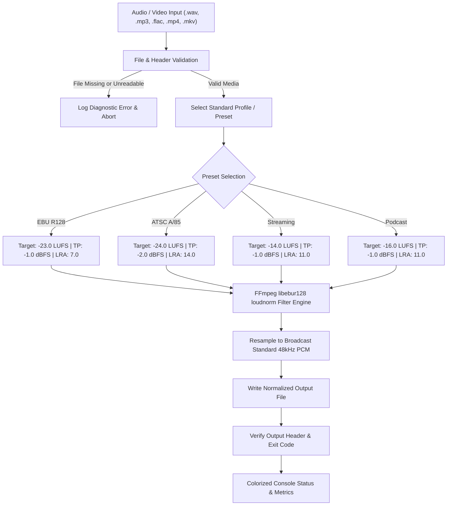

# 🎚️ audio-loudness-normalizer

> **Topics:** `ebu-r128` `loudness-normalization` `ffmpeg` `broadcast-audio` `audio-engineering` `lufs` `true-peak`


[](https://github.com/MobileConduit/audio-loudness-normalizer/releases/tag/v1.0.0)
[](LICENSE)
[](https://github.com/MobileConduit)
[](https://github.com/MobileConduit/audio-loudness-normalizer/actions)
[](https://ffmpeg.org)

Broadcast automation utility ensuring compliance with international broadcast loudness regulations (**EBU R128** at -23 LUFS, **ATSC A/85** at -24 LUFS, and **Web streaming standards** at -14 LUFS) with dynamic true-peak limiting.

---

## 📐 Architecture & Processing Pipeline



---

## ⚡ Key Features

- **Multi-Standard Compliance**: Built-in presets for European Broadcast Union (**EBU R128**), North American (**ATSC A/85**), Web Streaming (**Spotify, YouTube, Apple Music**), and Podcasts.
- **Dynamic True-Peak Limiting**: Eliminates inter-sample clipping artifacts while preserving natural dynamic range.
- **Single File & Batch Directory Processing**: Seamlessly normalize individual files or entire folders of audio/video assets.
- **Colorized CLI Output**: Real-time terminal feedback with ANSI coloring and diagnostic error tracking.
- **Environment & JSON Configuration**: Configure once via `.env` or `config.json` with CLI argument override capabilities.
- **Cross-Platform Compatibility**: Fully functional on Linux, macOS, and Windows.

---

## 🚀 Quick Start

### 1. Requirements
Ensure **FFmpeg** is installed and accessible in your system PATH:
```bash
# Ubuntu / Debian
sudo apt-get install -y ffmpeg

# macOS
brew install ffmpeg

# Windows (via Chocolatey or Winget)
winget install Gyan.FFmpeg
```

### 2. Configuration
Copy the configuration template or customize `.env`:
```bash
cp .env.example .env
# or use config.json
```

**`config.json` structure:**
```json
{
  "target_i": -23.0,
  "target_tp": -1.0,
  "target_lra": 7.0,
  "sample_rate": 48000,
  "preset": "ebu_r128",
  "ffmpeg_path": "ffmpeg"
}
```

#---

## ⚙️ Installation & Setup

```bash
git clone https://github.com/MobileConduit/audio-loudness-normalizer.git
cd audio-loudness-normalizer
pip install -r requirements.txt
```

## 3. Usage Examples

**Standard EBU R128 Broadcast Normalization (-23 LUFS):**
```bash
python loudnorm.py --input raw_commercial.wav --lufs -23.0
```

**YouTube / Spotify Web Streaming Preset (-14 LUFS):**
```bash
python loudnorm.py --input master_track.wav --preset streaming
```

**Podcast / Spoken Word Delivery (-16 LUFS):**
```bash
python loudnorm.py --input episode_final.wav --preset podcast
```

**Batch Normalize an Entire Directory:**
```bash
python loudnorm.py --input ./raw_takes --output ./normalized_takes --preset ebu_r128
```

---

## ⚙️ Operational Flags & Options

| Flag | Short | Type | Default | Description |
|---|---|---|---|---|
| `--input` | `-i` | String | *Required* | Path to input audio/video file or directory |
| `--output` | `-o` | String | `normalized_<input>` | Output path for normalized file or directory |
| `--lufs` | | Float | `-23.0` | Target Integrated Loudness in LUFS |
| `--tp` | | Float | `-1.0` | Target True Peak in dBFS |
| `--lra` | | Float | `7.0` | Target Loudness Range (LU) |
| `--preset` | `-p` | String | `None` | Predefined profile: `ebu_r128`, `atsc_a85`, `streaming`, `podcast` |
| `--sample-rate` | `-sr`| Int | `48000` | Output sample rate in Hz |
| `--config` | `-c` | String | `config.json` | Path to JSON configuration file |
| `--env-file` | | String | `.env` | Path to .env environment variables file |
| `--no-color` | | Flag | `False` | Disable ANSI color codes in console output |

---

## 🧪 Automated Testing

Run the test suite:
```bash
python -m unittest discover -s tests -v
```

---

## 👤 Author & Maintainer

**Eng. MHD. Shadi AL-Hasan**  
- **Role:** Executive CTO & Enterprise Solutions Architect  
- **Email:** [mhd.shadi.alhasan@gmail.com](mailto:mhd.shadi.alhasan@gmail.com)  
- **Phone / WhatsApp:** [+963934005922](tel:+963934005922)  
- **Location:** Damascus, Syria  
- **GitHub:** [MobileConduit](https://github.com/MobileConduit)  

---

## 📄 License

This project is licensed under the MIT License - see the [LICENSE](LICENSE) file for details.  
Copyright (c) 2026 **MHD. Shadi AL-Hasan**. All rights reserved.